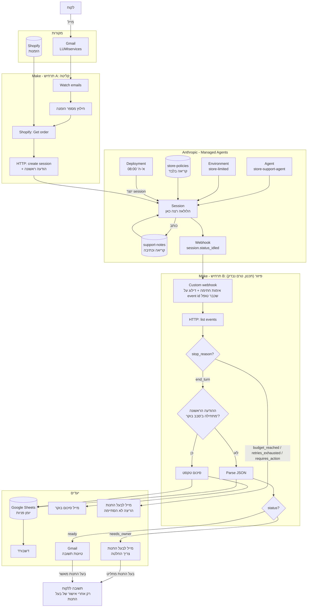
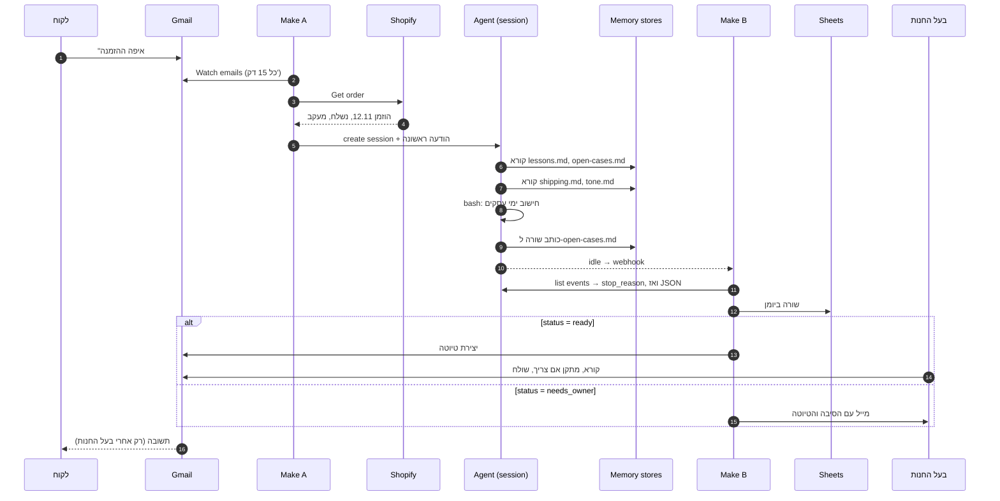

# Architecture - איך המידע זורם במערכת

הסוכן מתוכנן ב-[SPEC.md](SPEC.md). כאן: מה מפעיל אותו, מאיפה מגיע המידע, ולאן הולך הפלט.

## החלוקה בין המערכות

כמו שלמדנו בשיעור 5 וב-6: Make עושה את מה שקבוע, והסוכן עושה רק את מה שדורש שיקול דעת.

| רכיב | מה הוא | תפקיד |
|---|---|---|
| **Gmail** (LUMIservices) | תיבת השירות של החנות | מקור הפניות |
| **Make - תרחיש A** | אוטומציה | קולט מייל, מושך הזמנה משופיפיי, מפעיל את הסוכן |
| **Shopify** | בסיס הנתונים של ההזמנות | מקור האמת על הזמנות ומשלוחים |
| **Claude Managed Agent** | הסוכן | מסווג, משווה למדיניות, כותב טיוטה, מעדכן זיכרון |
| **Memory stores** | הזיכרון של הסוכן | מדיניות (קריאה בלבד) + מחברת (קריאה וכתיבה) |
| **Webhook של Anthropic** | פעמון | מודיע כשהסוכן סיים |
| **Make - תרחיש B** | אוטומציה | קורא את הפלט ומפזר אותו ליעדים |
| **Google Sheets** | יומן פניות + דשבורד | כל פנייה = שורה. ממנו נבנה הדשבורד |
| **Gmail - טיוטות** | יעד | טיוטת תשובה שמחכה לאישור שלי |
| **מייל לבעל החנות** | יעד | התראה על פנייה שצריכה החלטה, וסיכום יומי |

## תרשים 1 - כל המערכת

## שני טריגרים

### טריגר 1 - הודעה: מייל של לקוח נכנס

זה הטריגר העיקרי. כל מייל חדש בתיבת השירות מפעיל session אחד.

1. **Make A - Gmail Watch emails** בודק את התיבה כל 15 דקות. ממיין החוצה מיילים שאינם פניות (שופיפיי, פרסומות) לפי כתובת השולח.
2. **חילוץ מספר הזמנה** בביטוי פשוט (`#1043`). אם אין מספר, ממשיכים בלי.
3. **Shopify - Get order** מושך תאריך הזמנה, סטטוס ומספר מעקב. שם, טלפון וכתובת לא עוברים לסוכן, כי הוא לא צריך אותם.
4. **HTTP - create session** אל `POST /v1/sessions` עם: מזהה הסוכן והגרסה, ה-environment, שני ה-memory stores, תקציב 0.50$, וההודעה הראשונה (המייל + פרטי ההזמנה).
5. הסוכן רץ. בסוף הוא נכנס למצב idle.

**למה Make ולא הסוכן קורא את המייל בעצמו?** כי זה שלב קבוע: אותו דבר בכל פעם, זול, ולא דורש שיקול דעת. כך גם לסוכן אין גישה לתיבת המייל כולה, רק לפנייה אחת.

### טריגר 2 - תזמון: סבב בוקר

**Deployment** ב-Console: ראשון עד חמישי ב-08:00, `Asia/Jerusalem`, ביטוי cron `0 8 * * 0-4`, תקציב 0.30$.

מה נבדק ב-Console ב-25.11.2026: ה-Deployment מסומן Paused, ובלשונית Runs מופיעה ריצה אחת בלבד - ידנית (Run now) ב-24.11. ריצה לפי התזמון עוד לא הייתה.

ההודעה הקבועה של הסבב:
> סבב בוקר. קרא את open-cases.md. רשום אילו פניות פתוחות יותר מ-3 ימים בלי תשובה, ואילו הזמנות עברו 14 ימי עסקים. מחק סגורות מלפני 30 יום. עדכן את last-run.md והחזר סיכום קצר.

הסבב לא נוגע בלקוחות. הוא רק מסדר את המחברת ומחזיר לי רשימה של מה שנפל בין הכיסאות. הוא עובד רק בזכות הזיכרון: בלי open-cases.md לא היה לו על מה לעבור.

ההרצה לא תהיה בדיוק ב-08:00. הפלטפורמה מוסיפה עד 9 דקות עיכוב כדי לפזר עומס, אז ההבטחה היא "עד 08:10".

## תרשים 2 - פנייה אחת מההתחלה עד הסוף

## תרחיש B - בדיקות לפני שמפזרים (תכנון, טרם נבדק)

התרחישים ב-Make עוד לא בנויים. זה מה שהם צריכים לעשות, לפי התיעוד של Managed Agents:

1. **אימות חתימה.** כל webhook מגיע עם הכותרות `webhook-id`, `webhook-timestamp` ו-`webhook-signature` (HMAC). בקשה שהחתימה שלה לא תקינה נזרקת. עוד לא בדקתי אם Make יודע לאמת HMAC על גוף הבקשה הגולמי. אם לא, החלופה היא שרת קטן שמשתמש ב-`webhooks.unwrap` של ה-SDK ומעביר ל-Make רק בקשות תקינות.
2. **בלי כפילויות.** אותו אירוע יכול להגיע יותר מפעם אחת, ובכל ניסיון ה-event id זהה. Make שומר כל id בלשונית `Processed` ומדלג על id שכבר קיים.
3. **למה ה-session עצר.** ה-webhook לא כולל את סיבת העצירה. Make שולף את רשימת האירועים ובודק את ה-`stop_reason` של ה-`session.status_idle` האחרון. רק `end_turn` הוא סיום רגיל. `budget_reached` (נגמר התקציב), `retries_exhausted` (תקלה) או `requires_action` (מחכה לאישור) הולכים אליי כתקלה, ולא כתוצאה.
4. **שני מסלולים.** אם ההודעה הראשונה ב-session מתחילה ב"סבב בוקר", הפלט הוא טקסט חופשי ולא JSON: הוא נשלח אליי במייל ונרשם כשורה ביומן. כל השאר עובר ל-Parse JSON ולפיזור לפי `status`.

## מה קורה עם הפלט

| שדה ב-JSON | לאן הולך | למה |
|---|---|---|
| כל השדות | שורה ב-Google Sheets, לשונית `Log` | יומן מלא. ממנו הדשבורד |
| `draft_reply` כש-`status=ready` | טיוטה ב-Gmail, בשרשור של הלקוח | אני רק קורא ולוחץ שלח |
| `draft_reply` + `reason` כש-`status=needs_owner` | מייל אליי + לשונית `Needs Owner` | החלטה שלי: זיכוי, פגם, לקוח כועס |
| סיכום סבב הבוקר (טקסט, לא JSON) | מייל אליי + שורה ביומן, במסלול נפרד | רשימת מה שנתקע |
| עלות ה-session | עמודה ביומן (מתוך `usage` של ה-session) | לדעת כמה עולה פנייה |

## בסיס הנתונים - יומן הפניות

Google Sheets, קובץ `LUMI Support Log`. זה ה"עולם" מהשיעור: הנתונים שכולם רואים, לא הזיכרון של הסוכן.

**לשונית Log**

| עמודה | דוגמה |
|---|---|
| received_at | 2026-11-24 10:12 |
| session_id | sesn_01... (קישור לצפייה ב-Console) |
| order | #1043 |
| category | where_is_order |
| status | ready |
| reason | 8 ימי עסקים, בתוך הטווח |
| repeat_contact | FALSE |
| draft_reply | היי, תודה שפנית... |
| owner_action | sent / edited / rejected (אני ממלא) |
| cost_usd | 0.04 |

**לשונית Needs Owner** - מסוננת מ-Log, רק `needs_owner` שעוד לא טופלו.

עמודת `owner_action` חשובה: אם אני מתקן הרבה טיוטות מאותו סוג, זה סימן שצריך כלל חדש ב-`lessons.md` או בהוראות.

## הדשבורד

Looker Studio מחובר לגיליון. ארבעה מספרים וגרף אחד:

- פניות השבוע
- אחוז `ready` מול `needs_owner`
- אחוז טיוטות שנשלחו בלי תיקון (`owner_action = sent`)
- עלות ממוצעת לפנייה
- גרף: פניות לפי סוג לאורך זמן

מספר 3 הוא המדד האמיתי לאיכות הסוכן. אם הוא נמוך, הסוכן לא חוסך לי זמן.

## איך אני עוקב שהכול עובד

שלושת הערוצים מהשיעור:

| ערוץ | אצלי | מתי |
|---|---|---|
| **Stream** | לא בשימוש | אין מישהו שצופה בזמן אמת |
| **Webhook** | `session.status_idled` לתרחיש B, `deployment_run.failed` למייל אליי (נשלח רק בריצה מתוזמנת, לא ב-Run now) | תמיד |
| **Records** | ה-Session viewer ב-Console + עמודת העלות ביומן | כשמשהו נראה מוזר, או בסוף החודש |

## מה קורה כשמשהו נשבר

| תקלה | מה קורה | מה עושים |
|---|---|---|
| ה-session לא מחזיר JSON תקין | תרחיש B שולח את הטקסט הגולמי אליי, שורה ביומן עם `status=error` | קורא ב-Session viewer מה קרה |
| הגענו לתקציב | ה-session נעצר ב-idle עם `budget_reached` | בודק למה. לא מעלה תקציב אוטומטית |
| Shopify לא מצא הזמנה | Make ממשיך בלי פרטי הזמנה, הסוכן מבקש מהלקוח את המספר | - |
| ריצת בוקר נכשלה | Deployment run עם שגיאה + webhook | Run now אחרי תיקון |
| אותו מייל נקלט פעמיים | Make בודק בגיליון אם ה-`messageId` כבר קיים לפני שיוצר session | (הלקח ממטלה 5: מניעת כפילות לפני Claude) |
| אותו webhook נשלח שוב | ה-event id זהה בכל ניסיון | Make מדלג על id שכבר נמצא בלשונית `Processed` (תכנון, טרם נבדק) |
| webhook לא נמסר אחרי 3 ניסיונות | האירוע נזרק | סבב הבוקר משווה את ה-sessions של אתמול ליומן ומסמן מה חסר (תכנון, טרם נבדק) |

## מה נבנה בפועל במטלה (שאלה 5)

מהתרשים בנויים ופועלים: Agent, Environment, שני ה-Memory stores, Session ידני (טריגר הודעה) ו-Deployment (טריגר תזמון). Make, Sheets והדשבורד הם התכנון להמשך. פירוט ב-[agent/config.md](agent/config.md).

